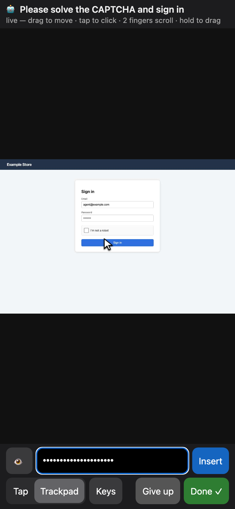
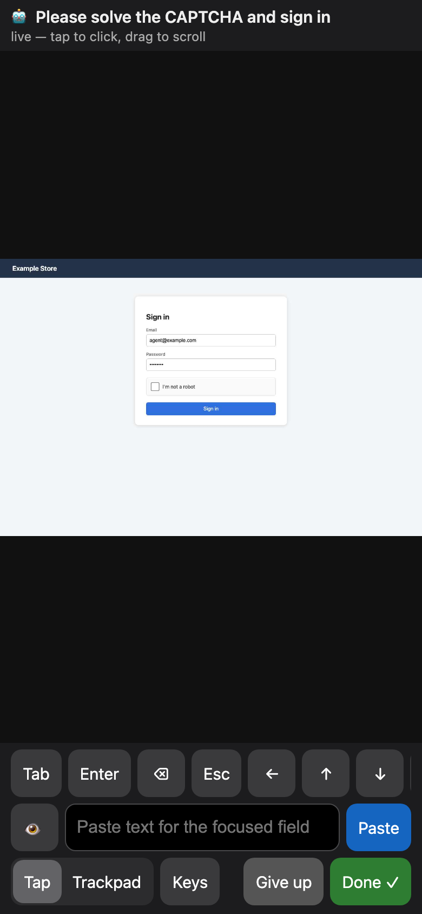

# Bosun

**The boatswain browser for agents.** A self-hosted browser service that gives AI agents a real browser — and
calls a human on deck when it needs one (CAPTCHA, cookie wall, 2FA).

> Status: **prototype (M0)**. Works end to end in one deployment; APIs will change. See [docs/DESIGN.md](docs/DESIGN.md)
> and [CHANGELOG.md](CHANGELOG.md).

## What it does today

- Headful Chromium (Playwright) under Xvfb — fewer bot flags than headless.
- **Engines** (`ENGINE`, or `engine` on `session_open`): `chromium` (default), `patchright` (Chromium without the
  CDP/automation leaks) and `camoufox` (anti-detect Firefox). See [docs/ENGINES.md](docs/ENGINES.md) for what each one
  passes and what it costs.
- MCP server over **stdio** (Claude Code, Codex, …) or **WebSocket** (shared service).
- Tools: `session_open` / `session_close` / `sessions`, `navigate`, `read` (accessibility snapshot with element
  refs), `click`, `type`, `select`, `press`, `back`, `wait_for`, `screenshot`, `request_human`, `handoff_wait`,
  `keepalive_set` / `keepalive_list` / `keepalive_remove`.
- **Keepalive** for persistent profiles: scheduled visits keep sliding login sessions alive without a model, and a
  logged-out profile raises an MCPL `bosun:needs-human` push event. See [Keeping logins alive](#keeping-logins-alive).
- Sessions are **ephemeral** (wiped on close) or use a named **persistent profile** of the tenant (stays logged in;
  no RAM while idle). A session belongs to the connection that opened it: other connections can't see, use or close
  it, and it is closed when that connection goes away or after `IDLE_TIMEOUT_SEC` without use.
- `navigate` accepts only `http://` and `https://` URLs.
- **Bot-wall detection** after navigation/click (Cloudflare challenge pages, CAPTCHA iframes, "access denied" texts).
  A bot check that keeps reloading itself (IP reputation) is reported as such: `bot check keeps reloading (likely IP
  reputation); try engine chromium + request_human, or another network`.
- **Human handoff:** `request_human` returns a link (15 min) to a **live view** of the tab, made for a phone:
  **Trackpad** mode (cursor, drag to move, tap to click, two fingers scroll, hold and drag for sliders) or **Tap**
  mode, a masked **paste bar** for passwords and codes, a key strip, a desktop mouse works as usual. The link can be
  reopened (one viewer at a time) until **Done** resumes the agent. See [Handoff](#handoff) for what is and isn't
  protected.

## Run

```sh
npm ci                                   # add --omit=optional to skip patchright/camoufox
npx playwright install --with-deps chromium
npx patchright install chromium          # only for ENGINE=patchright
npx camoufox-js fetch                    # only for ENGINE=camoufox (Node 22+)
npm test            # headless, against a local test server; no internet needed
npm run test:engines  # the same suite once per installed engine

# stdio (an MCP client spawns it)
xvfb-run -a node src/server.mjs

# WebSocket service + live view, reachable over a VPN interface (here 100.64.0.10)
WS_HOST=100.64.0.10 WS_PORT=7360 BROWSER_TOKEN=<32+ random chars> \
LIVE_HOST=100.64.0.10 LIVE_PORT=7350 LIVE_BASE_URL=http://100.64.0.10:7350 \
  xvfb-run -a -s "-screen 0 1366x900x24" node src/server.mjs
```

Clients authenticate with `Authorization: Bearer <token>` (the old `?token=` query parameter still works but puts
the secret in URLs and logs; prefer the header). The WebSocket listener **refuses to start** on a non-loopback
address without a token; on loopback an unauthenticated listener needs `ALLOW_NO_TOKEN=1` (local development only).
The two listeners are separate: `WS_HOST`/`WS_PORT` carry MCP (token-protected), `LIVE_HOST`/`LIVE_PORT` serve the
human's live view (protected by the handoff link). Both default to `127.0.0.1`; bind them to a VPN/mesh address or
put a TLS reverse proxy in front, and set `LIVE_BASE_URL` to the address the human's phone uses.

### Environment

| variable | default | |
|---|---|---|
| `BROWSER_TOKEN` | – | token for tenant `default` (16+ chars) |
| `BROWSER_TOKENS` | – | more tenants: `alice:<token>,bob:<token>` |
| `WS_HOST` / `WS_PORT` | `127.0.0.1` / – | WebSocket MCP listener (stdio when `WS_PORT` is unset) |
| `WS_ALLOWED_ORIGINS` | – | comma list of browser Origins allowed to connect (non-browser clients send none) |
| `ALLOW_NO_TOKEN` | – | `1` = no auth, loopback only |
| `MAX_CONNECTIONS` | 32 | concurrent WebSocket connections |
| `MAX_INFLIGHT` | 8 | concurrent tool calls per connection |
| `LIVE_HOST` / `LIVE_PORT` / `LIVE_BASE_URL` | `127.0.0.1` / – / derived | live view listener and the URL put in links |
| `HANDOFF_TTL_SEC` | 900 | handoff link lifetime |
| `BROWSER_DATA` | `./data` | profiles (`profiles/<tenant>/<name>`) and saved screenshots |
| `HEADLESS` | – | `1` = headless browser (more detectable; use for tests) |
| `ENGINE` | `chromium` | default engine: `chromium`, `patchright`, `camoufox` (must be installed, or startup fails) |
| `CAMOUFOX_OS` | host OS | OS of the Camoufox fingerprint: `macos`, `windows`, `linux` |
| `MAX_SESSIONS` | 3 | sessions across all tenants |
| `MAX_SESSIONS_PER_TENANT` | `MAX_SESSIONS` | |
| `IDLE_TIMEOUT_SEC` | 900 | close sessions unused this long (`0` = never; a session in handoff is never idle) |
| `MAX_PAGES_PER_SESSION` | 5 | popups beyond this are closed |
| `KEEPALIVE` | `1` | `0` = don't run scheduled keepalive visits (schedules are kept) |
| `MAX_DOM_NODES` | 60000 | `read` (a11y, whole page) refuses larger pages; pass `selector` |
| `SAVE_SHOTS` / `SHOTS_PER_SESSION` | – / 20 | `1` = also keep screenshots on disk (0600, deleted when the session closes) |

All numbers are validated at startup; a bad value stops the service instead of silently disabling a limit.

### Engines

| engine | process model | live view | notes |
|---|---|---|---|
| `chromium` | one shared browser, a context per session | CDP screencast | Playwright's Chromium |
| `patchright` | a browser per session (persistent context; temp profile for ephemeral sessions) | CDP screencast | patchright's recommended setup: no custom UA, no automation-flag args, window-sized viewport |
| `camoufox` | a browser per session | Playwright screencast + `page.mouse`/`keyboard` | fingerprint (window, screen, fonts, UA) from Camoufox; `humanize` off (hangs clicks with Playwright 1.64) |

A session asking for an engine that isn't installed gets an error naming the install command; there is no silent
fallback to another engine. A persistent profile remembers its engine family (Chromium or Firefox) and refuses the
other. patchright and camoufox-js are `optionalDependencies`; their browsers are separate downloads.

Chromium spawns many threads: under systemd give the unit a generous `TasksMax` (e.g. 2000).

## Handoff

<p>
</p>

- **One viewer at a time, reopenable until the end.** While the handoff runs, the link opens the live view whenever
  nobody else is connected — closing a chat app's in-app browser and tapping the link again works. A second viewer
  is refused (its page says the link is open on another device and retries) until the first disconnects or has been
  silent for more than 5 s. Opening the page alone (e.g. a link preview) doesn't connect. Done, Give up, expiry,
  `session_close` and disconnect of the agent end the handoff; from then on the link is dead (404).
- **Controls** (bottom bar): **Tap | Trackpad** (trackpad is the default on touch screens), **Keys** (Tab, Enter, ⌫,
  Esc, arrows, and the phone keyboard), the **paste bar**, **Give up**, **Done**. Trackpad: one finger moves the
  cursor (accelerated), tap clicks at the cursor, two fingers scroll, hold then drag holds the button down. The
  service moves the page's mouse along an interpolated, slightly jittered path rather than jumping.
- **Paste bar:** paste (long-press → Paste on iOS) or type into the masked field, then **Insert** or Enter: the text
  goes into the page's focused field (tap that field first) and the bar is cleared. The eye button shows what's in
  it. The text is not logged, not kept by the service after it is typed, and never sent to the agent — but once it
  is in the page, the page field rules below apply (a password field is masked; an ordinary field is not).
- A reconnecting viewer gets the last frame at once, and a page that doesn't repaint is re-captured every 2 s.
- While a handoff is active **every** page tool (`read`, `screenshot`, `navigate`, `click`, `type`, `select`,
  `press`, `back`, `wait_for`) is refused, and `sessions`/`handoff_wait` report no URL or title. Tool calls that were
  already running when `request_human` came in finish first; the human gets the tab after them.
- `handoff_wait` waits 50 s by default (below the MCP SDK's 60 s request timeout); call it again on `still_waiting`.
  Longer `timeoutSec` needs a longer client-side request timeout.
- After the handoff the agent can read the page again. What the human typed into **password, PIN, OTP and card
  security-code fields** (detected by input type, `autocomplete`, name/id and label, across frames and open shadow
  roots, including show-password toggles) is masked as `[masked]` in `read` output and blacked out in screenshots.
  After **Give up / timeout / cancel** those fields are emptied before the agent resumes; if that fails, the
  session is closed instead. If a frame can't be inspected, `read`/`screenshot` fail rather than return unmasked
  output. The handoff ends only after the human's last input has reached the page.
- A password field that is revealed with a show-password toggle stays masked: an event-driven tracker remembers every
  input that ever was `type=password` (incl. shadow roots), and Bosun also notes them when a handoff starts and every
  500 ms during it. On `chromium` Bosun's helpers run in the page's own JavaScript world, so a page can detect them;
  on `patchright` and `camoufox` they run in an isolated world (details in [docs/ENGINES.md](docs/ENGINES.md)).
- Not protected: text the human types into ordinary fields, secrets the page itself echoes as normal text, custom
  widgets that aren't `<input>`/`<textarea>` (e.g. per-digit OTP boxes built from `div`s), closed shadow roots.
  Those are visible to the agent after Done. Ask the human to finish the login (submit it) before pressing Done.

## Keeping logins alive

A persistent profile stays logged in only as long as the site's session does. Many sites extend the session each
time it is used ("sliding" sessions) and end it after some idle time. Bosun can visit a profile on a schedule so
that idle time never runs out — **without a model**:

```jsonc
// once, after the human logged the profile in (session_open({profile:"shop"}) + request_human)
keepalive_set({ "profile": "shop", "url": "https://shop.example/account",
                "every_hours": 12, "jitter_min": 30,                     // defaults; every_hours >= 1
                "logged_in_check": { "text": "My account" } })          // or selector / url_not_contains
keepalive_list()     // schedule, next run, last results: ok | logged_out | bot_check | error
keepalive_remove({ "profile": "shop" })
```

Each visit, at `every_hours` ± `jitter_min` (first one a period after `keepalive_set`):

- opens the profile with the **engine and mode it was last used with** (recorded in the profile; a profile used
  headful is never opened headless, so the fingerprint stays the same);
- loads `url`, then for 20–60 s moves the mouse along human-looking paths (the live view's trackpad interpolation),
  scrolls 1–3 times and sometimes rests over a link. It **never clicks, types or navigates**;
- checks `logged_in_check` (every given condition must hold: `text` visible, `selector` visible, URL doesn't
  contain `url_not_contains`), closes the profile and records the result (time, status, duration; last 10 kept).

Visits run one at a time, a few minutes apart, and never take the last free session slot from agents. A profile an
agent has open is skipped (it's in use anyway); an agent opening a profile during a visit takes it over at once.
Schedules and results live in `BROWSER_DATA/keepalive.json` (mode 0600) and survive restarts. Nothing from the
page is stored or logged beyond the check result.

When a visit finds the profile **logged out** or stuck at a **bot check**, Bosun pushes an MCPL event to the
tenant's agent (feature set `bosun.handoff`, tags `bosun:needs-human`, `bosun:source=keepalive`,
`bosun:reason=logged-out|bot-check`, `bosun:profile=<name>`; origin `{profile, url, reason}`), so the agent can open
the profile and call `request_human`. Events are only sent to connections whose host asked for MCPL at
initialize and granted `pushEvents` (`featureSets/update`); if none is connected, up to 20 per tenant wait for the
next one. There is no retry loop: the next attempt is the next scheduled visit.

**Limits — what this can't do:**

- It only helps sites with **sliding sessions**. A cookie with an absolute expiry (e.g. "remember me for 30 days")
  ends on that date however often the profile is visited.
- **Device re-verification, periodic re-login and 2FA prompts** still need a human (that's what the event is for).
- Visits look like a person glancing at the page, but **too-frequent visits can look bot-like**, especially at
  the same time every day — hence the 12 h default and the jitter. Don't go below a few hours unless the site's
  idle timeout requires it.
- The visit runs from Bosun's IP with Bosun's browser; if the site ties the session to a different network or
  device, keeping it alive here doesn't help.

## Security notes

- One service is one trust domain per **tenant** (token): a tenant's connections share its persistent profiles;
  sessions are private to the connection. For hard isolation run one process (and data dir) per tenant.
- Web content is untrusted (prompt injection). Run the service where it **can't reach private networks**
  (block 10/8, 172.16/12, 192.168/16, 100.64/10, 169.254/16 egress) — otherwise a page can steer it at your LAN.
  The `http(s)`-only check on `navigate` does not replace that boundary. Run it as a user that can't read secrets.
- Live-view links are **bearer tokens for the whole handoff** (up to `HANDOFF_TTL_SEC`): anyone holding the link can
  open the live view whenever nobody else is connected, or 5 s after the connected viewer went silent. Serve them on
  a private network (VPN/mesh) or behind TLS, send them over a private channel, and press Done or Give up when
  finished — that revokes the link for good (no replay afterwards). A connected, responsive viewer can't be pushed
  out by a second one.
- No rate limiting yet beyond the connection, in-flight and session caps.

## Roadmap

M1 tenant quotas/audit log, mobile viewport for handoff, more push events (handoff done/timeout) · M2 vault (`fill_credential`), downloads as content
references, watch · M3 macros.

## License

MIT
